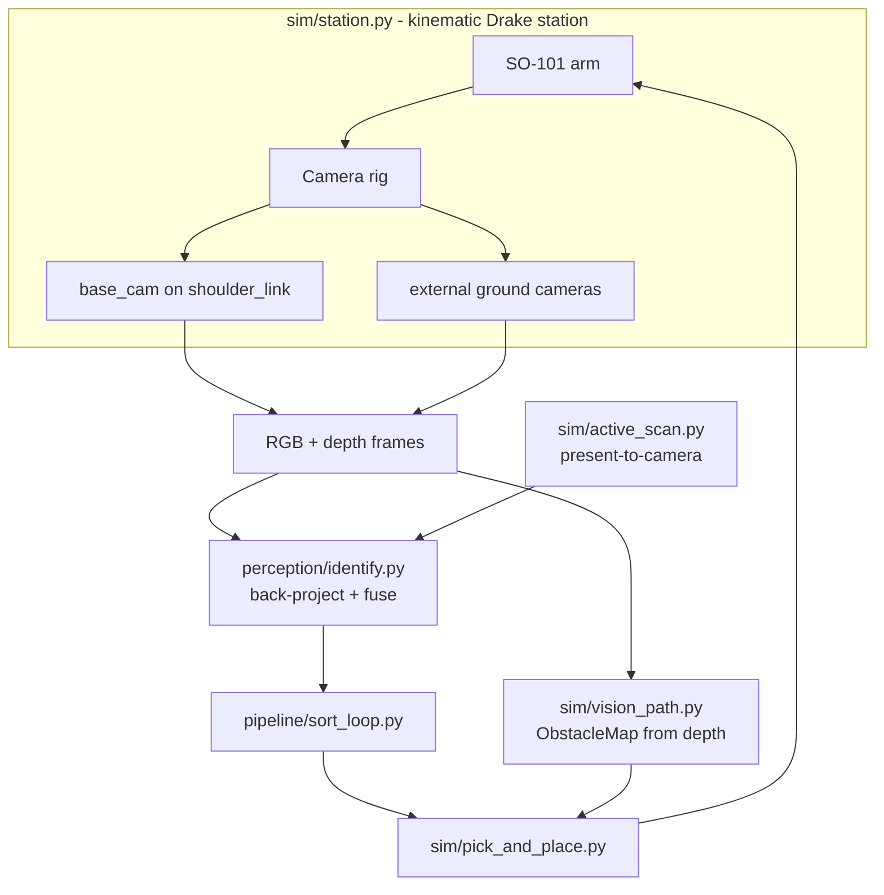

# Design Document

## Overview

The camera/vision subsystem gives the kinematic SO-101 sorter three capabilities:
locate items, identify them by QR, and move the arm safely around obstacles. It
is built on a multi-camera rig (a base wide-angle camera on the arm plus
configurable external ground cameras) and a kinematic Drake station. All
perceptual decisions derive from rendered camera frames + depth so the same code
tolerates sim/real differences.

This design is retrospective: it documents the implemented architecture so future
work has a reference. Module paths are under `src/pantrysort/`.

## Architecture

## Components and Interfaces

### Camera rig (`sim/camera.py`)
- `CameraSpec` declares a camera (mount frame, pose or look-at, intrinsics,
  fisheye coeffs). `default_rig()` returns the base + external specs; `load_rig`
  reads a YAML. `add_rig` wires each as a Drake `RgbdSensor` with a VTK renderer.
- `CameraModel` holds intrinsics + world pose and does pixel<->world projection.
- `apply_fisheye` distorts the pinhole render cosmetically; localization uses the
  undistorted pinhole model so positions stay accurate.

### Identification (`perception/identify.py`, `perception/qr.py`)
- `decode_qr_codes` decodes, with a corner-based rectification fallback for
  oblique views.
- `Obstacle`/`CameraView` carry a frame + a `locate(u,v)->world` closure + an
  optional watch region. `identify()` back-projects every decoded QR, matches to
  the nearest item within tolerance, and fuses by majority vote.

### Active scanning (`sim/active_scan.py`)
- `present_and_read` grasps an item the rig could not read, lifts it to a
  reachable camera at close range, decodes, and (via `expected_world`) accepts
  only the read that back-projects to the held item. `keep_held` leaves it
  grasped so pick-and-place can place it without a re-grasp.

### Motion & obstacle avoidance (`sim/pick_and_place.py`, `sim/vision_path.py`, `sim/station.py`)
- `move_ee_to` (IK + joint-step clamp) and `move_ee_to_smooth`/`_ramp_to`
  (velocity/accel limited) drive the arm.
- `ObstacleMap.from_station` builds a world obstacle point set from camera depth,
  masking the ground, the arm's own links, and the held item.
- `lift_over_obstacles` / `plan_step` raise an EE step over obstacles while
  keeping a ground margin. The carry phase routes horizontally by base-swing and
  lifts vertically to clear clutter.
- Placement lowers the item near the surface then settles it in small steps
  (`drop_held_onto`), with the wrist pre-turning the item so it does not spin.

## Data Models

- `CameraSpec`, `CameraModel` (camera geometry).
- `IdentifiedItem` (fused label + position + voting cameras + confidence).
- `ObstacleMap` (world points + ground_z) with `hits` / `min_clearance`.
- Scene modes via `PANTRYSORT_SCENE_MODE`: `flat_grid`, `belt_bare`, `belt_boxes`.

## Error Handling

- Missing VTK renderer: cameras return None; identification falls back to
  ground-truth scene labels (logic-only runs).
- QR not decodable passively: fall back to active present-to-camera; if still
  unread, the item is routed to the misc bin rather than blocking.
- IK non-convergence: keep best effort, clamped so the arm never snaps.
- Empty obstacle map: motion proceeds with only the ground margin enforced.

## Testing Strategy

- Pure-numpy unit tests (no Drake) for projection, fusion/watch regions
  (`tests/test_identify.py`), fisheye (`tests/test_camera.py`), and obstacle
  stepping (`tests/test_vision_path.py`).
- Drake-gated tests build the station and assert localization near ground truth.
- Diagnostics (`scripts/camera_diagnostic.py`, `scripts/run_sim_record.py`) save
  frames/videos under `outputs/` for visual inspection.

## Correctness Properties

### Property 1: Localization accuracy
A known item's world position, projected to a camera pixel and back-projected
through that camera's depth, returns within a small tolerance (x,y within a few
cm; z at the item's top surface).

**Validates: Requirements 2.1**

### Property 2: Identification soundness
Every item in `_identifications` is labeled with a QR that back-projects to
within the match tolerance of that item, and a QR outside a camera's watch region
never labels an item.

**Validates: Requirements 2.1, 2.2, 2.3**

### Property 3: No teleport
Between consecutive sim frames an item's position changes by at most a small
bound (no `SetFreeBodyPose` jumps); verified at <= ~0.06 m/frame.

**Validates: Requirements 3.1**

### Property 4: Gentle placement
A released item's per-frame descent is bounded by `MAX_DROP_STEP`, and the item
does not spin on release.

**Validates: Requirements 3.2**

### Property 5: Obstacle clearance
Along a planned carry path the end-effector stays at least the safety radius from
every obstacle point and above `ground_z + ground_margin`.

**Validates: Requirements 3.3, 3.4**

## Boundary with the pantry app and Supabase

This design ends at a verified item placement and a structured sort result. The
next integration layer is specified in
`.kiro/specs/pantry-app-integration/design.md` and should receive a typed event,
not directly mutate legacy `inventory_items` plus `inventory_transactions` in
separate requests.

The integration boundary must:

1. Resolve the PS1 SKU through the canonical catalog.
2. Translate legacy robot categories to current app categories, using SKU facts
   when a broad value such as `canned` is ambiguous.
3. Preserve lot, expiry, provenance, and confidence metadata.
4. Call one atomic robot-intake operation after placement.
5. Use an idempotency key so a retry cannot duplicate stock.

Camera-vision tests remain independent of Supabase credentials. Drake-gated
integration tests may inject a fake inventory gateway.
