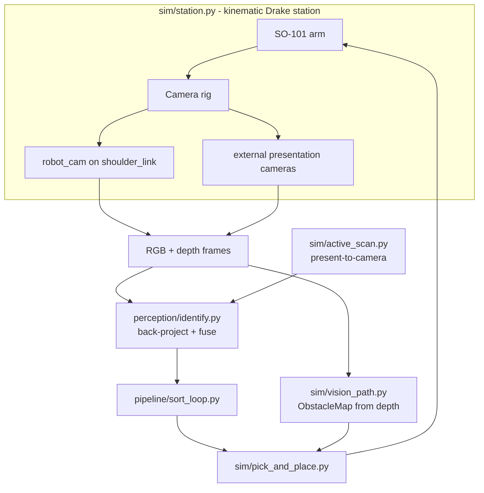
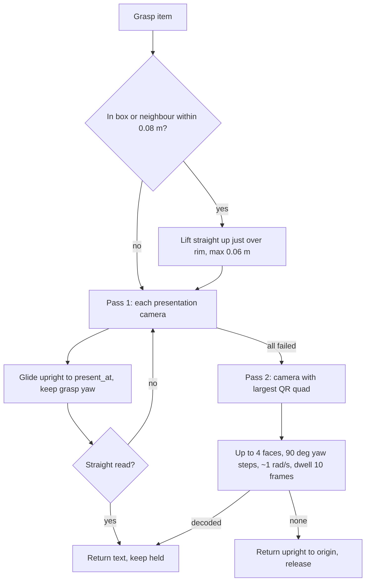

# Design Document

## Overview

The camera/vision subsystem gives the kinematic SO-101 sorter three capabilities:
locate items, identify them by QR, and move the arm safely around obstacles. It
is built on a multi-camera rig (a base wide-angle camera on the arm plus
configurable external cameras) and a kinematic Drake station. All perceptual
decisions derive from rendered camera frames + depth so the same code tolerates
sim/real differences.

The first sections document the implemented architecture. The "Revision: active
presentation" section describes the fix for the regression introduced by the
collision-reduction commits (`b855e47`, `ab3c40e`). Module paths are under
`src/pantrysort/`.

## Architecture

## Components and Interfaces

### Camera rig (`sim/camera.py`)
- `CameraSpec` declares a camera (mount frame, pose or look-at, intrinsics,
  fisheye coeffs) plus `present: bool = False` and
  `present_at: tuple | None = None`. `default_rig()` returns the base + external
  specs; `load_rig` reads a YAML (including the presentation fields). `add_rig`
  wires each as a Drake `RgbdSensor` with a VTK renderer.
- `presentation_cameras(specs)` returns the names of specs with `present=True`
  and a `present_at` point. `robot_cam` is never a presentation camera.
- `CameraModel` holds intrinsics + world pose and does pixel<->world projection.
- `apply_fisheye` distorts the pinhole render cosmetically; localization uses the
  undistorted pinhole model so positions stay accurate.

### Identification (`perception/identify.py`, `perception/qr.py`)
- `decode_qr_codes` decodes, with a corner-based rectification fallback for
  oblique views.
- `CameraView` carries a frame + a `locate(u,v)->world` closure + an optional
  watch region. `identify()` back-projects every decoded QR, matches to the
  nearest item within tolerance, and fuses by majority vote.

### Active scanning (`sim/active_scan.py`)
See "Revision: active presentation" below for the current flow.

### Motion & obstacle avoidance (`sim/pick_and_place.py`, `sim/vision_path.py`, `sim/station.py`)
- `move_ee_to` (IK + joint-step clamp) and `move_ee_to_smooth`/`_ramp_to`
  (velocity/accel limited) drive the arm.
- `ObstacleMap.from_station` builds a world obstacle point set from camera depth,
  masking the ground, the arm's own links, and the held item.
- `lift_over_obstacles` / `plan_step` raise an EE step over obstacles while
  keeping a ground margin. The carry phase routes horizontally by base-swing and
  lifts vertically to clear clutter.
- Placement lowers the item near the surface then settles it in small steps
  (`drop_held_onto`), with the wrist pre-turning the item so it does not spin.

## Revision: active presentation

### Root cause
- `ab3c40e` inserted `_lift_straight_up`, an open-loop 8 cm lift built from ten
  rate-limited `move_ee_to` calls (each clamped by `MAX_JOINT_STEP`). It can stop
  short and leaves an awkward IK seed for the next move.
- Present targets were computed 0.12 to 0.18 m along each camera's optical axis.
  For `robot_cam` (first in the list, rides `shoulder_link`) that point is about
  (0.27, 0, 0.02): low, inside the box, and moving with the pan. For the
  floor-level iPhone cameras at (0.40, +/-0.30, 0.03) it is about
  (0.33, +/-0.18, 0.04): on the belt, at belt height, near the reach limit, and
  next to queued boxes.
- With the item misplaced, `_read_presented` failed and `_reorient_and_read`
  swept about 15 roll x tilt poses quickly, tilting the item and never reading.

### Camera placement
- `iphone_left` / `iphone_right` move onto short stands beside the belt
  (x > BELT_X + BELT_WIDTH/2), raised to z ~0.12 to 0.15, each aimed at its own
  `present_at` point ~0.15 m away at radius 0.20 to 0.25 m from `PAN_AXIS_XY`
  and z ~0.13 to 0.15 (above box rims and items). Names are unchanged so
  recording scripts and diagnostics keep working. Exact coordinates are tuned
  against the geometry and reachability tests.
- `robot_cam` keeps its pose and its role in passive identification and
  recording; it is excluded from presentation.

### Upright IK (`sim/station.py`)
- `_ArmIK._solve_once` / `solve` accept optional `item_up_in_hand` (the held
  item's up axis expressed in the `gripper_link` frame) and `item_yaw` (world yaw
  of the item's x axis). When given, they replace the default approach-tilt and
  jaw-heading constraints with `AddAngleBetweenVectorsConstraint` on the
  `gripper_link` frame (~0.05 rad tolerance): item up parallel to world +z, item
  x at `item_yaw`.
- `Station.held_item_up_in_hand()` derives that vector from the stored `X_HI`
  and the item's world up at grasp time.
- `Station.move_held_upright_to(p, yaw, dt, max_speed=MAX_JOINT_SPEED)` solves
  the upright IK and ramps there with `_ramp_to`, converging exactly (no
  per-call clamp shortfall). Returns success.
- `_reachable` accepts the same constraints.

### Presentation flow (`sim/active_scan.py`)

- `_clearance_needed(station, label)` returns the lift height from box wall
  height (item in `_in_box`) and neighbour heights from `item_shapes` within
  0.08 m, capped at 0.06 m; 0 for isolated items.
- Pass 1 records the largest detected QR quad area per camera via `_qr_signal`
  and decodes with `_read_presented`, whose `pos_tol` is half the item's largest
  dimension plus 0.03 m.
- Pass 2 (`_rotate_and_read`) runs once, at a single presentation camera's
  `present_at`, never inside the per-camera pass-1 loop and never for
  `robot_cam`. It visits yaw offsets k*90 deg (k = 1..3; 0 was tried) as one
  monotonic sweep in whichever direction `wrist_roll_room` allows (+90, +180,
  +270 or the negatives). If neither direction fits 270 deg, it takes the
  reachable stops in the roomier direction and skips the rest, so cumulative
  yaw travel never exceeds 360 deg. Each stop ramps at ~1.0 rad/s and holds still
  for `ceil(0.5 / dt)` frames before reading. No `wrist_flex` tilt.
- `present_point_for_camera` returns the spec's `present_at`; `PRESENT_DISTANCES`,
  `_search_offsets` and the tilt sweep are removed.
- `_lower_and_release` returns the item with the upright move.

## Data Models

- `CameraSpec` (adds `present`, `present_at`), `CameraModel` (camera geometry).
- `IdentifiedItem` (fused label + position + voting cameras + confidence).
- `ObstacleMap` (world points + ground_z) with `hits` / `min_clearance`.
- Scene modes via `PANTRYSORT_SCENE_MODE`: `flat_grid`, `belt_bare`, `belt_boxes`.

## Error Handling

- Missing VTK renderer: cameras return None; identification falls back to
  ground-truth scene labels (logic-only runs).
- QR not decodable passively: active presentation; if still unread after the
  rotation search, the item is returned upright, released, and routed to misc.
- Upright IK fails for a present point or rotation stop: that camera or stop is
  skipped; never fall back to a tilted pose.
- IK non-convergence elsewhere: keep best effort, clamped so the arm never snaps.
- Empty obstacle map: motion proceeds with only the ground margin enforced.

## Testing Strategy

- Pure-numpy unit tests (no Drake): projection, fusion/watch regions
  (`tests/test_identify.py`), fisheye and rig placement geometry
  (`tests/test_camera.py`), obstacle stepping (`tests/test_vision_path.py`).
- Drake-gated tests (`pytest.importorskip("pydrake")`, skip without VTK) in
  `tests/test_active_scan.py`: upright IK, lift, presentation, rotation, and an
  end-to-end sort on `flat_grid` and `belt_boxes`.
- All commands run inside WSL, for example
  `wsl -e bash -lc "cd '/mnt/c/Users/AxisS/Downloads/Personal Projects/hackachusetts' && ~/.venvs/pantrysort/bin/python -m pytest tests/ -p no:cacheprovider"`.
- Diagnostics (`scripts/camera_diagnostic.py`, `scripts/run_sim_record.py`) save
  frames/videos under `outputs/` for visual inspection.

## Correctness Properties

### Property 1: Localization accuracy
A known item's world position, projected to a camera pixel and back-projected
through that camera's depth, returns within a small tolerance (x,y within a few
cm; z at the item's top surface).

**Validates: Requirements 2.1**

### Property 2: Identification soundness
Every item in `_identifications` is labeled with a QR that back-projects to
within the match tolerance of that item, and a QR outside a camera's watch region
never labels an item.

**Validates: Requirements 2.1, 2.2, 2.3**

### Property 3: No teleport
Between consecutive sim frames an item's position changes by at most a small
bound (no `SetFreeBodyPose` jumps); verified at <= ~0.06 m/frame.

**Validates: Requirements 3.1**

### Property 4: Gentle placement
A released item's per-frame descent is bounded by `MAX_DROP_STEP`, and the item
does not spin on release.

**Validates: Requirements 3.2**

### Property 5: Obstacle clearance
Along a planned carry path the end-effector stays at least the safety radius from
every obstacle point and above `ground_z + ground_margin`.

**Validates: Requirements 3.3, 3.4**

### Property 6: Camera placement soundness
For every presentation camera: its position is outside the belt footprint, box
footprints and bin drop points and above the rim height; its `present_at` lies on
its optical axis within 1 cm at 0.12 to 0.18 m, at radius 0.15 to 0.30 m from the
pan axis and z >= 0.10 m. `robot_cam` is never a presentation camera.

**Validates: Requirements 1.2, 1.4, 1.5**

### Property 7: Upright hold
For every frame from grasp to release or handoff during active presentation, the
held item's up axis is within 5 degrees of world +z.

**Validates: Requirements 5.4**

### Property 8: Straight read first
When the straight read at a presentation camera succeeds, the rotation search is
never invoked and the item is within 2 cm of that camera's `present_at`.

**Validates: Requirements 5.3, 5.8**

### Property 9: Bounded, slow rotation
The rotation search runs at most once per item, at one presentation camera's
`present_at` (item within 2 cm), makes at most 4 face stops, consecutive yaw
changes are 90 +/- 5 degrees in one direction, cumulative yaw travel is at most
360 degrees, the item is held still >= 0.5 s at each stop, per-frame wrist motion
stays within the ~1.0 rad/s cap, and `wrist_flex` is not used for search.

**Validates: Requirements 5.5, 5.6, 5.9**

### Property 10: Lift only when needed
A boxed or crowded item is lifted to its planned clearance (within 1 cm, x,y
drift under 1 cm, at most 0.06 m); an isolated item is not lifted.

**Validates: Requirements 5.1, 5.2**

## Boundary with the pantry app and Supabase

This design ends at a verified item placement and a structured sort result. The
next integration layer is specified in
`.kiro/specs/pantry-app-integration/design.md` and should receive a typed event,
not directly mutate legacy `inventory_items` plus `inventory_transactions` in
separate requests.

The integration boundary must:

1. Resolve the PS1 SKU through the canonical catalog.
2. Translate legacy robot categories to current app categories, using SKU facts
   when a broad value such as `canned` is ambiguous.
3. Preserve lot, expiry, provenance, and confidence metadata.
4. Call one atomic robot-intake operation after placement.
5. Use an idempotency key so a retry cannot duplicate stock.

Camera-vision tests remain independent of Supabase credentials. Drake-gated
integration tests may inject a fake inventory gateway.
