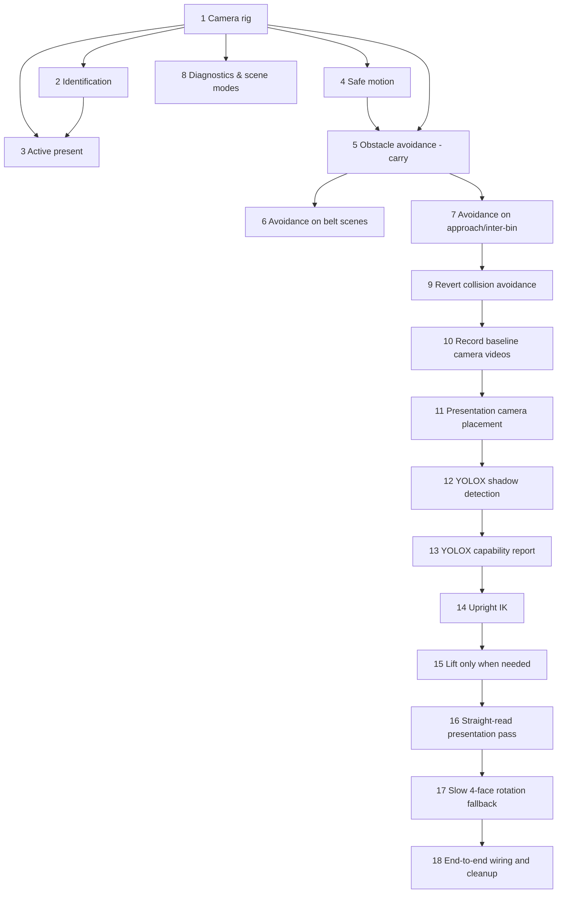

# Implementation Plan

## Overview

Camera/vision for the SO-101 sorter: a configurable camera rig, QR
identification with active present-to-camera fallback, smooth/safe motion, and
vision-derived obstacle avoidance. Tasks 1-8 are implemented. Task 9 reverts the depth-obstacle
motion, task 10 records a baseline, and tasks 11-16 fix the
active-presentation regression from the collision-reduction work: proper
presentation-camera placement, upright holding, lift only when needed, a
straight-read pass first, and a slow 4-face rotation as the last resort.

All Python, pytest and ruff commands run inside WSL, from the repo root:
`wsl -e bash -lc "cd '/mnt/c/Users/AxisS/Downloads/Personal Projects/hackachusetts' && ~/.venvs/pantrysort/bin/python -m pytest tests/ -p no:cacheprovider"`

## Task Dependency Graph



```json
{
  "waves": [
    { "wave": 1, "tasks": ["1"] },
    { "wave": 2, "tasks": ["2", "4", "8"] },
    { "wave": 3, "tasks": ["3", "5"] },
    { "wave": 4, "tasks": ["6", "7"] },
    { "wave": 5, "tasks": ["9"] },
    { "wave": 6, "tasks": ["10"] },
    { "wave": 7, "tasks": ["11"] },
    { "wave": 8, "tasks": ["12"] },
    { "wave": 9, "tasks": ["13"] },
    { "wave": 10, "tasks": ["14"] },
    { "wave": 11, "tasks": ["15"] },
    { "wave": 12, "tasks": ["16"] },
    { "wave": 13, "tasks": ["17"] },
    { "wave": 14, "tasks": ["18"] }
  ]
}
```
## Tasks

- [x] 1. Build the configurable camera rig
  - `CameraSpec`, `CameraModel`, `default_rig`, `load_rig`, `add_rig`; base
    fisheye + external ground cameras; fetch SO-101 assets, STL->OBJ for Drake.
  - _Requirements: 1.1, 1.2, 1.3_

- [x] 2. Identify items from the rig
  - Decode QR per camera with corner rectification; back-project + match to the
    nearest item; fuse by majority vote; enforce watch regions.
  - _Requirements: 2.1, 2.2, 2.3, 2.5_

- [x] 3. Active present-to-camera fallback
  - Grasp and present an unreadable item to a reachable camera; accept only the
    read that back-projects to the held item; keep it held for placement.
  - _Requirements: 2.4_

- [x] 4. Smooth, safe motion and placement
  - Velocity/acceleration-limited moves + joint-step clamp; lower before release
    and settle gently; wrist pre-turns the item; no teleport-on-restore.
  - _Requirements: 3.1, 3.2_

- [x] 5. Vision-based obstacle avoidance for the carry path
  - `ObstacleMap.from_station` from camera depth (ground/arm/held filtered);
    `lift_over_obstacles`/`plan_step` raise the EE over obstacles above a ground
    margin; wired into transport; pure-numpy unit tests.
  - _Requirements: 3.3, 3.4_

- [x] 6. Extend obstacle avoidance to the belt scenes
  - Validate/tune on `belt_bare` then `belt_boxes` (box walls + neighbors).
  - _Requirements: 3.3, 3.4, 4.2_

- [x] 7. Obstacle-aware approach and inter-item moves
  - Apply avoidance during approach/grasp and when swinging between bins, not
    just during the carry.
  - _Requirements: 3.3, 3.4_

- [x] 8. Diagnostics and scene modes
  - Save camera frames/videos under `outputs/` per run; support `flat_grid`,
    `belt_bare`, `belt_boxes`.
  - _Requirements: 4.1, 4.2_

- [x] 9. Revert the collision-avoidance motion changes
  - Use `git show` on `7802faf`, `b855e47` and `ab3c40e` to separate the
    collision-avoidance changes from the placement fixes.
  - Remove: the depth `ObstacleMap` / `lift_over_obstacles` wiring in
    `src/pantrysort/sim/pick_and_place.py` (`execute_pick_and_place`,
    `_transport_and_drop`, `_build_obstacles`, `_held_labels`, the
    `descending` gate) so approach/carry follow the pre-avoidance motion
    (`_step_around_base` + hover over the drop); and the `_lift_straight_up`
    call / `LIFT_CLEARANCE` in `src/pantrysort/sim/active_scan.py` (task 15
    replaces it). Leave `sim/vision_path.py` and `tests/test_vision_path.py` in
    place as an unused library so they can be reused later.
  - Keep: drop-height fixes (lower to ~1.5 cm before release, `MAX_DROP_STEP`
    gentle settle, `pos[2] = max(pos[2], end[2])` clamp), no-teleport moves
    (`_lower_and_release` glide, `_ramp_to`, joint-step clamp), and no-spin
    release (`drop_held_onto(..., yaw=None)`, wrist pre-turn via `_choose_turn`,
    `already_held` handoff). Leave `_reorient_and_read` as-is (task 17
    replaces it).
  - Update the camera-vision steering/docstrings that describe the carry path as
    obstacle-aware.
  - Run the full test suite and `ruff check` in WSL; both must pass.
  - _Requirements: 3.1, 3.2, 3.3_

- [x] 10. Record baseline base and external camera videos
  - In WSL run headless:
    `~/.venvs/pantrysort/bin/python scripts/run_sim_record.py --no-meshcat`
    (records `robot_cam` -> `arm_base_view.mp4` and `iphone_left` ->
    `external_view.mp4` under `outputs/sim_recordings/<timestamp>/`). The script
    blocks only when Meshcat is on, so headless it exits on its own; use a
    generous timeout.
  - If the script fails, fix only what blocks recording (no behavior changes).
  - Report the output folder, both file paths and sizes, the sorted count, and
    the log lines for active scans (which camera, reorient attempts) as the
    pre-fix baseline.
  - _Requirements: 4.1_
- [x] 11. Presentation camera placement and rig fields
  - In `src/pantrysort/sim/camera.py` add `present: bool = False` and
    `present_at: tuple[float, float, float] | None = None` to `CameraSpec`; parse
    both in `load_rig` (convert `present_at` to a float tuple).
  - Add `presentation_cameras(specs) -> list[str]` (specs with `present=True`
    and a `present_at`).
  - Move `iphone_left` / `iphone_right` off the floor onto raised stands beside
    the belt (x > BELT_X + BELT_WIDTH/2, z ~0.12-0.15), each with `present=True`
    and a `present_at` ~0.15 m along its optical axis at radius 0.20-0.25 m from
    `PAN_AXIS_XY`, z ~0.13-0.15; set `look_at` so the axis passes through
    `present_at` while the frame still covers the pick-station box. Keep names.
    `robot_cam` stays `present=False`. Update the module docstring.
  - Add pure-numpy tests to `tests/test_camera.py` (above the pydrake skip):
    placement soundness per Property 6 (outside belt/box/bin footprints, above
    rim height, `present_at` on the axis within 1 cm at 0.12-0.18 m, radius and
    z bounds, `world_to_pixel(present_at)` near image center using a pinhole
    model built from the spec), `robot_cam` not a presentation camera, and a
    YAML round-trip of the new fields via `load_rig` (tmp_path).
  - _Requirements: 1.2, 1.3, 1.4, 1.5_

- [x] 12. YOLOX shadow detection in the view pipeline
  - Add `onnxruntime` (pinned exact version) as an optional extra `yolo` in
    `pyproject.toml`; install it into the WSL venv. Download pretrained
    Apache-2.0 YOLOX COCO ONNX weights (yolox_s or yolox_nano from the official
    Megvii-BaseDetection release, pinned URL + SHA-256) to a cache dir outside the
    repo (e.g. `~/.cache/pantrysort/yolox/`), gitignore any local copy. No
    training or fine-tuning of any kind.
  - New `src/pantrysort/perception/yolo.py`: `YoloxDetector` (lazy import,
    letterbox preprocess, decode grid outputs, NMS, COCO 80 names) returning
    `YoloDetection(cls_name, score, box_xyxy, center_px)`; `make_detector()`
    returns None if onnxruntime/weights are missing or `PANTRYSORT_YOLO` is off
    (config flag in `config.py`, default on when available).
  - Item-to-COCO mapping table for the scene catalog (e.g. Apple -> apple,
    bottles -> bottle, everything with no COCO class -> None/unmappable).
  - `YoloShadowTracker`: for each item identification (passive frames and the
    active-presentation frame), run YOLO on that camera frame, match detections
    to the item by back-projecting the box center with `station.locate_pixel`
    (nearest item within tolerance), and record camera, QR label (ground truth),
    expected COCO class, top YOLO class + score, matched/correct/unmappable and
    inference latency. YOLO never changes the QR identification or routing.
  - Hook into `SortLoop` (only when a detector is available); at the end of
    `run()` log a one-line summary and write `outputs/yolo/<timestamp>/`
    (`observations.jsonl`, `summary.json`). Attach the result to `SortResult`.
  - Pure tests (`tests/test_yolo.py`, no onnxruntime needed): NMS/decode on
    synthetic outputs, letterbox box un-mapping, mapping table, tracker accuracy
    math with a fake detector, and that QR results/routing are unchanged with a
    detector that always predicts wrong. Detector smoke test gated on
    onnxruntime + weights.
  - Run full suite and ruff (sim/tests/scripts/perception) in WSL.
  - _Requirements: 6.1, 6.2, 6.3, 6.4, 6.5_

- [ ] 13. YOLOX capability report
  - Run the sim headless with YOLO on in `flat_grid` and `belt_boxes`
    (`run_sim.py` or `run_sim_record.py --no-meshcat`), collecting the shadow
    outputs from task 12. Also run the detector over saved frames from both
    `robot_cam` (pinhole and fisheye) and an iPhone camera.
  - Write `docs/yolo_report.md`: model + license + setup; per-item table (QR
    label, expected COCO class, detected?, top class/score, camera); overall
    detection rate and accuracy on mappable items; coverage of the catalog by
    COCO; CPU latency; failure modes (missing classes, small objects, render
    domain gap, fisheye, occlusion in boxes, held-in-gripper views); where it
    could help without training (presence/localization cues, sanity checks) and
    where it can't; and zero-shot options for later. No training.
  - Save 3-6 annotated example frames under `docs/images/yolo/` referenced by the
    report.
  - _Requirements: 6.6_
- [ ] 14. Upright IK for held items
  - In `src/pantrysort/sim/station.py` extend `_ArmIK._solve_once` / `solve`
    with optional `item_up_in_hand` (3-vector in `gripper_link` frame) and
    `item_yaw` (rad). When given, replace the approach-tilt and jaw-heading
    constraints with angle constraints on `gripper_link`: item up parallel to
    world +z (~0.05 rad) and item x axis at `item_yaw` about world z (~0.05 rad).
  - Store the item's world up at grasp in `attach_nearest`; add
    `Station.held_item_up_in_hand()` and `Station.held_item_tilt()` (angle of
    the held item's up axis from world +z).
  - Add `Station.move_held_upright_to(p_W, yaw, dt, max_speed=MAX_JOINT_SPEED)`
    that solves the upright IK and ramps with `_ramp_to`; returns success.
  - Make `active_scan._reachable` accept `item_up_in_hand` / `item_yaw` and pass
    them to the IK.
  - Create `tests/test_active_scan.py` (`pytest.importorskip("pydrake")`, skip if
    no cameras): build a `flat_grid` station, grasp an item, assert each
    presentation camera's `present_at` is reachable upright, and that after
    `move_held_upright_to` the tilt is < 5 deg and the grasp point is within
    1.5 cm; yaw targets +90 and +180 deg are hit within 5 deg while upright.
  - _Requirements: 5.3, 5.4_

- [ ] 15. Lift only when needed
  - In `src/pantrysort/sim/active_scan.py` replace `_lift_straight_up` /
    `LIFT_CLEARANCE` with `_clearance_needed(station, label)` (box wall height
    if the item is in `station._in_box`; neighbour heights from `item_shapes`
    within 0.08 m; capped at 0.06 m; 0 if isolated) and `_lift_if_needed`, which
    keeps x,y and calls `move_held_upright_to` to the planned height.
  - Tests in `tests/test_active_scan.py`: a boxed (`belt_boxes`) or crowded item
    ends within 1 cm of its planned height with x,y drift < 1 cm and lift
    <= 0.06 m; an isolated item is not lifted (no EE z change).
  - _Requirements: 5.1, 5.2, 5.4_

- [ ] 16. Straight-read presentation pass
  - Rework `present_and_read` to iterate only `presentation_cameras` (via the
    station's `camera_specs`), glide upright to each camera's `present_at`
    keeping the grasp yaw, dwell `hold_frames`, then `_read_presented`.
  - Record the largest detected QR quad area per camera with `_qr_signal`.
  - Make `_read_presented` / `_qr_signal` `pos_tol` = half the item's largest
    dimension + 0.03 m.
  - `present_point_for_camera` returns the spec's `present_at`; remove
    `PRESENT_DISTANCE(S)` and the optical-axis search. Do not call the rotation
    search yet in this task (leave a hook for task 17).
  - `_lower_and_release` returns the item using the upright move.
  - Tests: a known item presented decodes to its own payload with no rotation
    (monkeypatch the rotation function to fail if called); item within 2 cm of
    `present_at` at read time; a `station.frame_hooks` sampler asserts tilt
    < 5 deg on every frame; no target is derived from `robot_cam`.
  - _Requirements: 2.4, 5.3, 5.4, 5.7, 5.8_

- [ ] 17. Slow 4-face rotation as the last resort
  - Replace `_reorient_and_read` / `_search_offsets` with `_rotate_and_read`,
    called only after pass 1 fails at every presentation camera. Use the camera
    with the largest recorded quad area (fallback: first presentation camera).
  - Runs once per item at that camera's `present_at` only: never inside the
    pass-1 camera loop, never at `robot_cam`, never during grasp/lift/glide/
    carry. Remove the per-camera `_reorient_and_read` call entirely.
  - Stops at yaw offsets k*90 deg (k = 1..3; 0 was already tried) as one
    monotonic sweep in the direction `wrist_roll_room` allows; if 270 deg does
    not fit either way, take the reachable stops in the roomier direction and skip
    the rest, so cumulative yaw travel is <= 360 deg. Each stop via
    `move_held_upright_to` with `max_speed` ~1.0 rad/s, then hold still
    `ceil(0.5 / dt)` frames (>= 0.5 s sim time) before reading; stop on first
    success. No `wrist_flex` tilt. Log each stop at INFO.
  - Tests: with an item whose sticker faces away from the camera (rotate the
    held item so pass 1 fails), the read succeeds within <= 4 faces;
    consecutive yaw changes 90 +/- 5 deg in one direction; cumulative yaw travel
    <= 360 deg; >= 0.5 s still at each stop; per-frame joint change <= cap * dt;
    tilt < 5 deg throughout; item within 2 cm of `present_at` whenever the yaw
    changes for search; rotation runs at most once per item and is not triggered
    when pass 1 succeeds.
  - _Requirements: 5.4, 5.5, 5.6, 5.7, 5.8, 5.9_

- [ ] 18. End-to-end wiring, cleanup and verification
  - Confirm `SortLoop._identify` / `keep_held` handoff into
    `pick_and_place._transport_and_drop` works from the new present pose.
  - Update `scripts/camera_diagnostic.py` to iterate presentation cameras; keep
    `run_sim_record.py` defaults valid. Remove dead code from the old sweep.
  - Update docstrings in `camera.py` / `active_scan.py` and the camera
    description in `.kiro/steering/project-context.md`.
  - Add Drake-gated end-to-end tests: `SortLoop(use_sim=True)` with meshcat off
    and realtime_rate 0 on `flat_grid` and `belt_boxes` identifies every item
    (no `Unlabeled item`) and sorts all of them.
  - Run the full suite and `ruff check` in WSL; both must pass.
  - _Requirements: 2.4, 4.3, 5.7_

## Notes

- Tasks 1-8 are implemented; tasks 9-18 are on `feature/obstacle-avoidance-rollout`.
- Task 9 retires the depth-obstacle carry routing (tasks 5-7) per user request;
  `vision_path.py` stays as an unused library.
- Root cause of the presentation regression: `ab3c40e`'s open-loop
  `_lift_straight_up` and optical-axis present targets (low and moving for
  `robot_cam`, on the belt at the reach limit for floor iPhone cameras), which
  triggered a fast roll x tilt sweep.
- Verify in WSL: `pytest tests/ -p no:cacheprovider` and `ruff check`.

## Status at merge

- Done: tasks 9-12. Task 13 (YOLOX report) is WIP: `scripts/yolo_eval.py` exists, the report does not.
- Tasks 14-18 not started as separate tasks; an interim presentation fix (straight reads at raised present points, slow once-per-item rotation) is live. Upright-IK APIs in `station.py` are unfinished and their 4 tests are skipped.

## Integration status

The camera-vision task list describes the current simulation boundary. The
robot-to-app/backend reconciliation is tracked separately in
`.kiro/specs/pantry-app-integration/`. Tasks 6-7 (depth obstacle avoidance) were
implemented on `feature/obstacle-avoidance-rollout` and then retired by task 9;
they are not active behavior. Once a sort placement is verified, the integration
spec requires an atomic, idempotent robot-intake event rather than direct legacy
table writes.