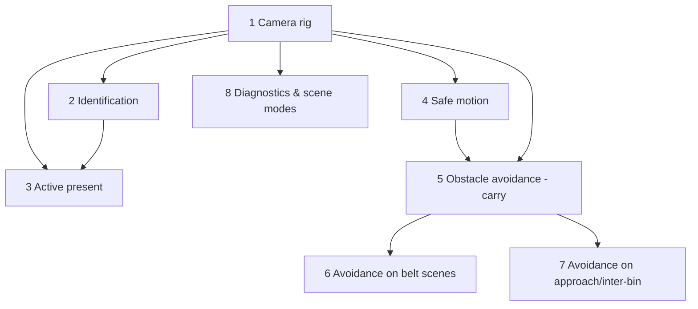

# Implementation Plan

## Overview

Camera/vision for the SO-101 sorter: a configurable camera rig, QR
identification with active present-to-camera fallback, smooth/safe motion, and
vision-derived obstacle avoidance. Most tasks are implemented (checked);
remaining work extends obstacle avoidance to the belt scenes and the
approach/inter-bin phases.

## Task Dependency Graph



```json
{
  "waves": [
    { "wave": 1, "tasks": ["1"] },
    { "wave": 2, "tasks": ["2", "4", "8"] },
    { "wave": 3, "tasks": ["3", "5"] },
    { "wave": 4, "tasks": ["6", "7"] }
  ]
}
```
## Tasks

- [x] 1. Build the configurable camera rig
  - `CameraSpec`, `CameraModel`, `default_rig`, `load_rig`, `add_rig`; base
    fisheye + external ground cameras; fetch SO-101 assets, STL->OBJ for Drake.
  - _Requirements: 1.1, 1.2, 1.3_

- [x] 2. Identify items from the rig
  - Decode QR per camera with corner rectification; back-project + match to the
    nearest item; fuse by majority vote; enforce watch regions.
  - _Requirements: 2.1, 2.2, 2.3, 2.5_

- [x] 3. Active present-to-camera fallback
  - Grasp and present an unreadable item to a reachable camera; accept only the
    read that back-projects to the held item; keep it held for placement.
  - _Requirements: 2.4_

- [x] 4. Smooth, safe motion and placement
  - Velocity/acceleration-limited moves + joint-step clamp; lower before release
    and settle gently; wrist pre-turns the item; no teleport-on-restore.
  - _Requirements: 3.1, 3.2_

- [x] 5. Vision-based obstacle avoidance for the carry path
  - `ObstacleMap.from_station` from camera depth (ground/arm/held filtered);
    `lift_over_obstacles`/`plan_step` raise the EE over obstacles above a ground
    margin; wired into transport; pure-numpy unit tests.
  - _Requirements: 3.3, 3.4_

- [x] 6. Extend obstacle avoidance to the belt scenes
  - Validate/tune on `belt_bare` then `belt_boxes` (box walls + neighbors).
  - _Requirements: 3.3, 3.4, 4.2_

- [x] 7. Obstacle-aware approach and inter-item moves
  - Apply avoidance during approach/grasp and when swinging between bins, not
    just during the carry.
  - _Requirements: 3.3, 3.4_

- [x] 8. Diagnostics and scene modes
  - Save camera frames/videos under `outputs/` per run; support `flat_grid`,
    `belt_bare`, `belt_boxes`.
  - _Requirements: 4.1, 4.2_

## Notes

- Tasks 1-5 and 8 are implemented and on `main`; task 5 is on
  `feature/vision-obstacle-pathing`.
- Tasks 6-7 (obstacle avoidance on belt scenes + approach phase) are implemented
  and verified: flat_grid 9/9, belt_bare 9/9, belt_boxes 13/13 sorted.
- Verify with `pytest tests/ -p no:cacheprovider` and `ruff check` (run in WSL).