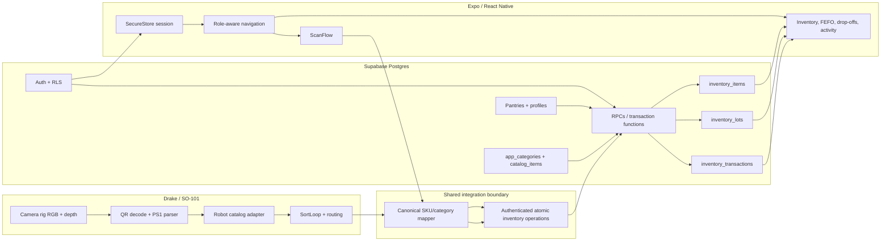

# Pantry App Integration — Design

## Status

Design derived from the requirements in `requirements.md`. The design assumes
that the latest migration-backed, lot-aware Supabase schema becomes the shared
production contract. It deliberately preserves the existing in-memory store and
camera-vision simulation seams during migration.

## Architecture overview



## Source-of-truth decisions

1. The latest Supabase migration chain is authoritative for production data.
2. `inventory_lots` is authoritative for per-expiration quantities.
3. `inventory_items.quantity` and `inventory_items.expiration_date` are derived
   aggregate values maintained by database triggers/RPCs.
4. `app_categories` is authoritative for persisted category keys.
5. `catalog_items` is authoritative for product facts once synchronized from
   `assets/catalog.yaml`.
6. The older `db/schema.sql` three-table contract is legacy documentation only
   and must not be used for new integration code.
7. The mobile app uses the anon key plus RLS. Any service-role operation belongs
   in a server-side/robot process and never in the app bundle.

## Integration components

### 1. Canonical catalog and category adapter

Add one explicit mapping layer at the Python boundary rather than changing
camera-vision labels in place.

Inputs, in priority order:

1. Known PS1 SKU lookup in `catalog_items` / synchronized catalog.
2. Known standard barcode lookup.
3. QR payload facts for fields not supplied by the catalog.
4. Package/OCR facts.
5. Legacy category fallback, producing `unknown` or review-required when the
   legacy value is ambiguous.
6. Manual review.

A generic legacy value such as `canned` must not blindly become `protein`:
SKU/product facts should distinguish beans/tuna from canned fruit or vegetables.
The adapter should return a canonical product record with:

- SKU and display name.
- Canonical app category.
- Calories and allergens.
- Image/tags/good-to-know metadata.
- Shelf-life facts.
- Fact provenance and confidence.

The adapter should be shared conceptually by the Python robot path and the
mobile scan path. The actual implementation may be language-specific, but the
precedence and mapping tables must be generated or tested from one source.

### 2. Robot integration gateway

Keep the existing `SortLoop` responsible for perception, routing, and motion.
Add a backend-facing gateway after a successful placement:

```text
RobotSortEvent
  pantry_id
  idempotency_key
  sku / barcode / raw_ps1_payload
  item_name
  canonical_category
  quantity
  expiration_date
  expiry_estimated
  lot_code
  unit_calories
  allergens
  storage_location_id
  source = robot
  simulation_run_id (optional)
```

The gateway should not write directly to multiple tables. It should call one
atomic backend operation and record the operation result in the sort result/log.
Simulation runs should inject a fake gateway or in-memory store.

### 3. Atomic inventory operations

The database boundary should provide operations equivalent to:

- `robot_intake(event)` — idempotent lot creation after successful placement.
- `scan_intake(event)` — creates/updates an item and lot from the app scanner.
- `consume_inventory(item_or_lot_selector, quantity, reason)` — FEFO
  distribution or discard with one transaction record.
- `accept_dropoffs(ids)` — existing donor review operation, made atomic per bag.
- `confirm_lot_date(lot_id, date)` — clears estimated status with staff access.

Each operation must:

1. Check authenticated role and pantry access.
2. Validate positive quantity and valid category/source values.
3. Lock/select eligible lots in expiration order.
4. Mutate lots and derived aggregate values together.
5. Append the lifecycle transaction together with the mutation.
6. Enforce idempotency where a robot retry could repeat an intake.
7. Return the resulting item/lot/transaction summary.

The exact function names may follow existing migration conventions, but the
semantics above must remain stable across Python and TypeScript clients.

### 4. App service layer

`app/lib/stash.ts` remains the app-facing service boundary. It should call the
atomic operations rather than implement quantity mutation followed by a second
transaction insert. UI screens should continue to use typed service functions
and should not issue business-critical raw table writes.

Existing role routing remains:

- Neighbor: public pantries, resources, eligible stock, saved pantries.
- Donor: needs, donations, scan/drop-off bag, bag handoff state.
- Staff: pantry home, inventory, scan, FEFO handout, discard, activity, drop-off
  acceptance.
- Owner/admin: pantry configuration and staff-management capabilities as
  supported by RLS/policy design.

### 5. QR and barcode flow

The Python and mobile implementations should share these rules:

- PS1 payloads are parsed and validated first.
- SKU lookup supplies canonical product identity.
- Standard barcode lookup follows when the code is not PS1.
- OCR may provide an expiry but must mark it estimated.
- A package-confirmed date overrides catalog/OCR estimates.
- Unknown products enter a reviewable `unknown` state and cannot silently map
  to an unrelated category.
- A scan preview shows name, category, quantity, expiry, and confidence before
  commit when uncertainty is material.

The six files under `assets/qr/` are fixtures. The complete product set comes
from the catalog/barcode assets and generated simulation labels.

### 6. Authorization and RLS

All pantry-scoped tables should use the authenticated user's pantry role. The
policy model must distinguish public reads from staff writes and donor-owned
pending drop-offs from accepted stock. A self-claim flow must not be treated as
production-grade staff verification without an explicit owner/approval rule.

The service-role key is permitted only for a server-side robot or administrative
process. The Expo bundle receives only the anon key.

### 7. Native mobile build

The app remains an Expo Router project with generated native iOS files. The
Release path is:

1. Fill `app/.env` with `EXPO_PUBLIC_SUPABASE_URL` and
   `EXPO_PUBLIC_SUPABASE_ANON_KEY`.
2. Generate/update native files with Expo prebuild when app config changes.
3. Open the workspace, configure automatic signing/team, and select a physical
   device.
4. Build the Release configuration so Metro is not required after install.
5. Verify auth, QR scanning, SecureStore persistence, RLS, and one inventory
   operation on-device.

The product name, scheme, bundle identifier, app icon, and generated native
project must be reconciled before calling the build production-ready.

## Migration strategy

### Phase 1: Freeze and compare

- Treat the latest migration chain as canonical.
- Generate a comparison table between Python dataclasses, Supabase columns,
  app types, and catalog fields.
- Decide the canonical product name and category mappings.
- Mark the old schema and stale app README as legacy.

### Phase 2: Database boundary

- Add/verify atomic intake and consume operations.
- Add idempotency for robot events.
- Add role/pantry checks and test RLS with representative users.
- Preserve existing `accept_dropoffs` behavior while making its transaction
  boundary explicit.

### Phase 3: Python adapter

- Extend domain objects with pantry/lot/source/provenance fields without
  breaking the in-memory API.
- Add canonical catalog/category translation.
- Implement a Supabase gateway that calls atomic operations.
- Keep a fake gateway for logic-only simulation and unit tests.

### Phase 4: App adapter

- Replace direct multi-request writes in `app/lib/stash.ts` with atomic service
  calls.
- Keep screen behavior and role routing stable.
- Update type definitions and error/loading states.
- Verify PS1/barcode/catalog behavior against shared fixtures.

### Phase 5: Native acceptance

- Reconcile Expo/native naming and config.
- Build Release to a physical iPhone.
- Run the documented acceptance checklist.

## Error handling

- Missing Supabase configuration: app shows setup guidance; local simulation
  defaults to memory.
- Unauthorized pantry action: return a clear RLS/role error with no mutation.
- Unknown SKU/category: preserve item as reviewable unknown, never guess silently.
- Duplicate robot retry: return the original idempotent result.
- Partial database failure: atomic operation rolls back all related changes.
- Network failure after robot placement: persist/retry the event using its
  idempotency key; do not silently claim the item was recorded.
- Expired intake: route to discard/quarantine according to the configured
  pantry policy.

## Testing strategy

1. Pure Python tests for category mapping, PS1 precedence, lot aggregation,
   FEFO, expiry estimation, idempotency keys, and in-memory parity.
2. SQL/RPC tests for concurrency, RLS, atomic rollback, and lot consumption.
3. Contract tests that compare Python and TypeScript row/event shapes.
4. Fixture tests for every QR under `assets/qr/` plus the full catalog.
5. Simulation tests that verify successful placement produces one backend event
   and a retry does not duplicate stock.
6. App tests for auth guards, role routes, scan preview, error states, and
   FEFO display.
7. Native Release acceptance on a physical iPhone without Metro.

## Correctness properties

### Property 1: Aggregate/lot conservation

For every item, aggregate quantity equals the sum of its positive lots after
any successful operation.

### Property 2: FEFO conservation

A successful consume operation removes units from the earliest eligible lots
and never consumes more than the available quantity.

### Property 3: Audit conservation

Every committed intake, distribution, discard, or accepted drop-off has exactly
one corresponding transaction record, and failed operations have none.

### Property 4: Catalog consistency

A known SKU resolves to the same canonical category and product facts in Python,
Supabase, and the app.

### Property 5: Authorization isolation

A user cannot read or mutate pantry-scoped data for an unauthorized pantry.

### Property 6: Native independence

A Release build can launch, authenticate, scan, and perform a permitted read or
write without a Metro process running.

## References

- [[file:.kiro/specs/pantry-app-integration/requirements.md]]
- [[file:.kiro/specs/camera-vision/design.md]]
- [[file:src/pantrysort/pipeline/sort_loop.py]]
- [[file:src/pantrysort/inventory/supabase_store.py]]
- [[file:supabase/migrations/20261024140000_lots_and_app_data.sql]]
- [[file:app/lib/stash.ts]]
- [[file:app/components/ScanFlow.tsx]]
