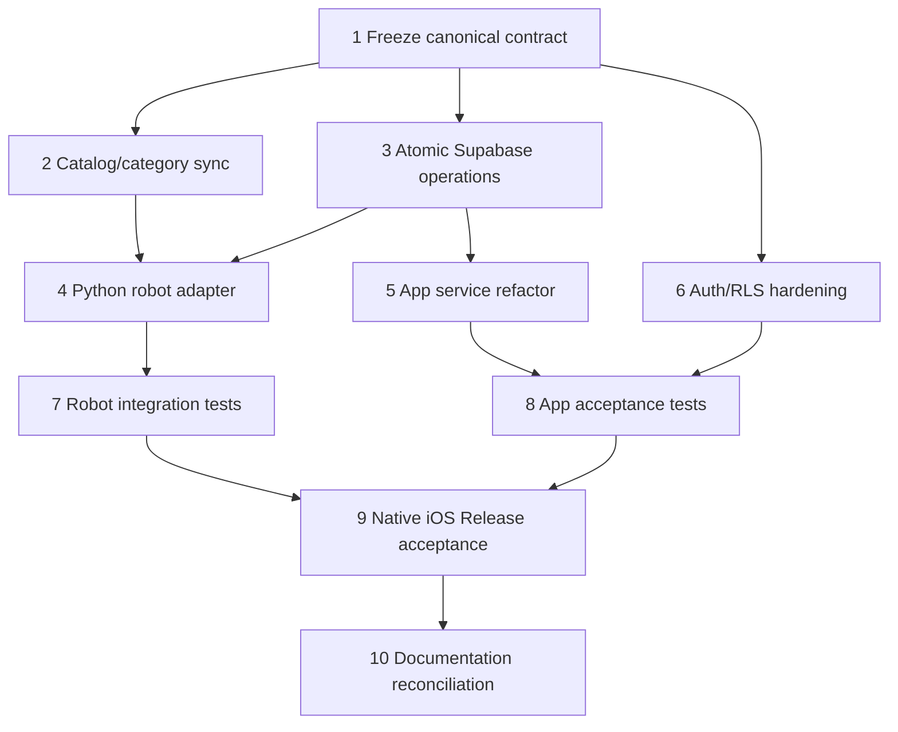

# Pantry App Integration — Implementation Tasks

## Status

Implementation plan derived from `requirements.md` and `design.md`. Tasks are
intentionally unstarted until the requirements and canonical product/data
choices are approved.

## Dependency graph



## Waves

```json
{
  "waves": [
    { "wave": 1, "tasks": ["1"] },
    { "wave": 2, "tasks": ["2", "3", "6"] },
    { "wave": 3, "tasks": ["4", "5"] },
    { "wave": 4, "tasks": ["7", "8"] },
    { "wave": 5, "tasks": ["9", "10"] }
  ]
}
```

## Tasks

- [ ] 1. Freeze the canonical product and data contract
  - Decide whether the release product name is PantrySort, Stash, or a documented
    transition between them.
  - Declare the latest migration-backed lot/pantry schema authoritative.
  - Produce a field-by-field comparison for Python models, SQL tables, app
    types, QR payloads, and catalog files.
  - Decide canonical category keys and document ambiguous legacy mappings.
  - Mark `db/schema.sql` and stale app README content as legacy.
  - _Requirements: 1, 2, 10_

- [ ] 2. Synchronize catalog, QR, barcode, and category data
  - Build a deterministic sync/check between `assets/catalog.yaml`, barcode
    assets, generated QR labels, `catalog_items`, and `app_categories`.
  - Resolve known calorie/category discrepancies.
  - Add fixture tests for every static QR and representative generated label.
  - Define fact precedence and unknown-product review behavior.
  - _Requirements: 1, 6_

- [ ] 3. Implement atomic Supabase inventory operations
  - Add or revise RPCs for robot intake, scan intake, FEFO consume/distribute,
    discard, lot-date confirmation, and drop-off acceptance.
  - Include pantry/role checks, validation, lot locks, transaction append, and
    idempotency for robot events.
  - Ensure failed operations roll back all item/lot/transaction changes.
  - Add SQL/RLS/concurrency tests using a test project or isolated database.
  - _Requirements: 2, 3, 4, 5_

- [ ] 4. Align the Python domain and robot gateway
  - Extend Python inventory/event models with pantry, lot, source, provenance,
    and estimated-expiry fields while preserving the in-memory API.
  - Implement canonical SKU/category translation at the robot boundary.
  - Replace multi-request Supabase item/transaction writes with atomic calls.
  - Add an injectable fake gateway for logic-only and simulation tests.
  - Preserve active QR scan, camera identification, and placement behavior.
  - _Requirements: 1, 3, 4, 5, 9_

- [ ] 5. Align the Expo app service layer
  - Update `app/lib/stash.ts` types and operations to use the canonical RPCs.
  - Remove business-critical update-then-insert inventory mutations from the
    client service layer.
  - Preserve staff/donor/neighbor routing and add clear pending/error states.
  - Show lot-level expiry and estimated-date status consistently.
  - _Requirements: 2, 3, 4, 7_

- [ ] 6. Harden roles and RLS
  - Document and implement pantry membership, staff, owner, donor, and neighbor
    access boundaries.
  - Review self-claim behavior and add an explicit approval/invitation path if
    required for production.
  - Verify no service-role credential exists in app source, env templates, or
    generated native assets.
  - Test unauthorized read/write attempts for every pantry-scoped table.
  - _Requirements: 2, 7, 8_

- [ ] 7. Add robot/backend contract and simulation tests
  - Test successful QR identification through sort-loop event creation.
  - Test expired-item routing and discard audit behavior.
  - Test duplicate event retry with no duplicate lot/transaction.
  - Test logic-only mode with no Drake, Supabase, or network.
  - Test current camera-vision behavior against the existing spec.
  - Keep camera-vision Tasks 6–7 separate until their unmerged work is validated.
  - _Requirements: 5, 9_

- [ ] 8. Add mobile integration and scan acceptance tests
  - Test auth guard and role-specific routes.
  - Test PS1, EAN/UPC/Code128, OCR-estimated expiry, unknown-code learning, and
    scan preview behavior.
  - Test FEFO display, lot-date confirmation, handout, discard, and drop-off
    acceptance error states.
  - Test RLS/network failures do not show false success.
  - _Requirements: 6, 7_

- [ ] 9. Verify production native iOS build
  - Reconcile display name, scheme, bundle identifier, icon, and app config.
  - Document supported Expo/Xcode/CocoaPods versions.
  - Generate/update native workspace and configure automatic signing.
  - Build Release to a physical iPhone without Metro.
  - Verify authentication, SecureStore persistence, QR camera, Supabase read,
    and one authorized inventory mutation.
  - Record the result without committing secrets, provisioning profiles, or
    local native artifacts.
  - _Requirements: 8_

- [ ] 10. Reconcile repository documentation
  - Update app README and Supabase setup docs to point to current migrations and
    `app/lib/stash.ts`.
  - Update `.kiro/steering/project-context.md` with the final contract and
    native build conventions.
  - Update `.kiro/CONTRIBUTIONS.md` with existing work and branch status.
  - Update the camera-vision spec's integration boundary and current task state.
  - _Requirements: 9, 10_

## Definition of done

- Robot and app use the same canonical category/catalog contract.
- Intake, distribution, discard, and drop-off operations are atomic and audited.
- FEFO is lot-aware and concurrency-safe.
- RLS isolates pantry-scoped data by role.
- Existing camera-vision simulation behavior remains intact.
- Static QR fixtures and catalog checks pass.
- The app builds and runs on a physical iPhone in Release without Metro.
- `.kiro` specs, steering, contributions, README, and migration references agree
  with the implementation.
